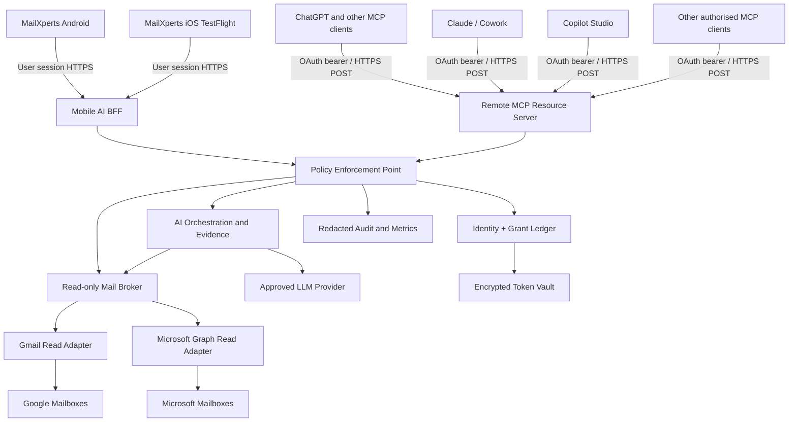
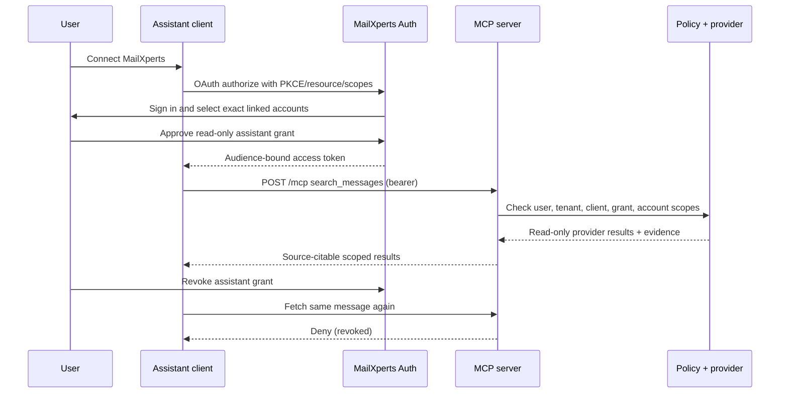

# MailXperts Universal AI: Proposed HLD + LLD

**ID:** MX-HLD-LLD-UNIVERSAL-AI-2026-11-13 | **State:** PROPOSED / SECURITY REVIEW REQUIRED | **Bound to:** Near-P0 SDLC plan (13 Nov 2026), MXAI-001..094, AI-025, AI-035, #34.

## 1. Architectural principles and scope

1. Shared **MailXperts Gateway** gives users two controlled paths: external AI assistants query authorised MailXperts mail through **read-only remote MCP**; MailXperts Android/iOS invoke an in-app AI API. The assistant-facing MCP service and native-mobile BFF **share authorisation and provider adapters** but never accept one another's tokens.
2. Authoritative identity is (tenant_id, user_id, account_id); account IDs are opaque and not email addresses. Every request explicitly resolves owner, platform client, tenant and permitted mailbox IDs. A missing account grant is a hard deny even if a provider token exists.
3. Mobile device vault remains local. Existing Android Keystore-backed credentials are not copied server-side; server mailbox access requires separate, fresh provider OAuth consent. iOS Keychain stores **only** native app session secrets, never shared provider refresh tokens.
4. Default assistant tools are **read-only**. Summarisation is derived response content, not mailbox mutation. No send, draft-save, delete, label, move, purchase, payment, account editing or arbitrary URL tools in beta.
5. Model content may not act as instruction authority. Only signed server configuration + user intent + scoped grants may govern access. Retain source references for citations; minimise, redact and bound material sent to LLM providers.
6. Follow current Model Context Protocol Streamable HTTP/auth specifications **and** verify negotiated protocol versions against actual target clients. The 2026-07-28 MCP revision altered HTTP behavior; do not assume earlier clients use identical GET/session patterns.

## 2. HLD: logical containers

### Logical dataflow

**Trust boundaries:** device/client vs public gateway; unauthenticated Internet vs MCP resource server; resource-server user token vs provider delegated token; mail content (untrusted) vs policy and tools; AI model output (untrusted) vs app-rendered content; one tenant vs another. Each boundary has independent authentication, data minimisation and circuit-breaker controls.

**Runtime components:**
- **IdP / OAuth AS:** user login, OAuth 2.1 authorisation code + PKCE for assistant clients, well-known OAuth discovery, protected-resource metadata, audience-bound access tokens, refresh/revoke, consent UI; use an established security-reviewed IdP where feasible.
- **MCP server:** stateless versioned protocol adapter, POST-only where negotiated MCP version requires it; read tool schema registry, validation, identity mapping, quotas; never directly handles raw provider credentials.
- **Mobile BFF:** session-scoped REST endpoints for account choices, summaries, question answers, source drill-through and privacy settings.
- **Grant service:** exact per-assistant per-user per-mailbox scopes and audit; revocation evaluated on every request, not only at token issuance.
- **Provider broker:** Google Gmail API read-only adapter and Microsoft Graph Mail.Read adapter. No SMTP/IMAP sends through MCP. Provider throttling and partial failures isolated.
- **AI service:** provider-neutral routing (OpenAI-first as approved), model allowlist, request budget, prompt-injection isolation, user consent, redaction, structured results and citations; request retention settings are provider-specific, never claim universal zero-retention.
- **Storage:** managed encrypted provider token vault; append-only metadata audit; optionally bounded encrypted metadata cache behind separate privacy approval. No default raw body persistence or vector index.
- **Operations:** Australian region preference subject to provider legal/technical support, threat monitoring, rate limits, incident kill switch and per-client feature flags.

### Physical deployment topology

- Separate dev, staging, beta and production logical environments, isolated issuer/client IDs, secret sets, encryption keys and data.
- Public HTTPS API gateway with WAF, TLS 1.2+, request/body size limits, service-to-service least privilege and authentication.
- Encrypted DB for tenant, account records, grants and audit metadata; KMS/HSM-managed key custody and rotation; no secrets in GitHub, Android resources, iOS binary, crash reports or fixture files.
- Provider-specific OAuth applications configured with the exact scopes and redirect URIs; Google restricted Gmail scopes can require verification/security assessment before broad use.
- Real-account QA limited to controlled opted-in mailboxes. Remote assistants may impose tenant/plan/admin configuration restrictions. Avoid claiming universal platform support until tested.

## 3. Mobile app design and code impact inventory

### Existing Android main baseline (v1.6.0-beta.7)
- **AccountConfig.java, AccountIdentity.java, AccountsActivity.java, ProviderPreset.java:** preserve stable account identities; add explicit mappings to server linked-account IDs without exporting local passwords.
- **GoogleOAuthManager.java, MicrosoftOAuthManager.java, OAuthConnectActivity.java, CredentialVault.java, SecureStore.java:** retain existing device-local flows; introduce separate backend linking flow through browser/PKCE, never reuse a device refresh token for cloud authorisation.
- **MailboxActivity.java, MainActivity.java, Navigation.java, SettingsActivity.java:** new AI workspace entry, explicit per-account consent and connected-assistant management; no interference with existing fast mailbox startup.
- **MailRepository.java, MailboxScope.java, SearchActivity.java, MailSearchSpec.java:** provide authorised message references and source drill-down; avoid exposing local unlinked mail under server MCP.
- **MailIntelligence.java, ComposeActivity.java:** AI draft result may populate existing editable composer in a later approved lane, but beta has no external send/write MCP capability.
- **LocalStore.java, BackgroundMailSync.java, SyncPlanner.java, SyncPolicy.java:** preserve local-first cache and sync functionality; no hidden account sync to a remote AI server.
- **app/build.gradle, AndroidManifest.xml, app/src/test/**: bump identity only for approved candidate; add OAuth deep-link/network-security policies and regression coverage; retain production package + signing lineage. Proposed beta v1.7.0-beta.1 only after code and testing.
- **Unmerged draft PR #27/#30/#33:** reconcile Build Expert server and AI consent code before cherry-picking or building anything; do not assume this code exists on main.

### New iOS delivery (not present in GitHub main; MXAI-089..094)
- **ios/MailXperts.xcodeproj + SwiftUI screens** (future): onboarding, read-only inbox/AI workspace, grant chooser, evidence-linked message detail and disconnect.
- **AuthSession / KeychainTokenStore:** OAuth/OIDC session, PKCE and secure token lifecycle; use system browser and universal links, not embedded credentials.
- **MailXpertsAPIClient / AIViewModel / ConsentViewModel:** same backend contract and explicit account selector as Android; never install generic IMAP credentials in first iOS MVP.
- **Mobile contract fixtures and accessibility tests:** Swift unit/UI automation, VoiceOver, dark/light contrast, offline/error states.
- **TestFlight:** Apple Developer signing/profile custody, privacy manifest/disclosures and beta tester feedback. A full native iOS IMAP/SMTP email client is a separate later programme requiring its own estimates.

### Backend impacts
- **Draft PR #27 Build Expert (server-side):** potential reusable infrastructure only; developer coding agent permission model is distinct from customer mail content and must not share broad scopes.
- **Draft PR #30 Mail AI endpoint:** review existing /v1/mail/tasks, request redaction, model allowlists, configuration and tests; do not call it a remote MCP server.
- **New backend service modules:** AuthAS/Resource metadata, grant ledger, provider token vault, Gmail/Graph adapters, mail normaliser, read tool registry, AI orchestrator, audit/metrics, admin kill switch, integration contract tests.
- **New CI:** gateway contract/security, Android and iOS builds, dependency scans, beta signing, staged live-provider testing.

## 4. LLD: domain models

**User:** id UUID, tenant_id, status, data_region, created_at. **AccountLink:** opaque id, tenant_id, owner_user_id, provider (google/microsoft), external_id_hash, display_address (for UI only), state, provider_scopes, vault_token_ref, created_at, last_verified_at. **AssistantGrant:** grant_id, tenant_id, owner_user_id, client_id, assistant_kind, account_ids[], read_scopes[], expires_at, revoked_at, consent_version, audit_event_id. **MessageRef:** account_id, provider, opaque_message_id, opaque_thread_id, permalink_ref (resolved after auth), received_at, subject, from_display, folder, snippet; raw provider IDs never used as authority. **Evidence:** source_ref, message_ref, offsets/snippet, retrieval_timestamp, freshness, provider and permission proof. **AuditEvent:** trace_id, subject_id_hash, assistant/client, scope, operation, count, outcome, latency, no raw body/token.

Database must enforce tenant and owner predicates on all account/grant joins; use row-level security where supported, plus independent service-layer checks. Never trust client-supplied tenant_id, ownership, provider_id or From address.

### Internal API (proposed /v1)
- POST /v1/account-links/authorization/start -> PKCE authorisation context; validate issuer/callback and anti-CSRF.
- GET /v1/account-links -> only user-owned linked accounts (no access tokens).
- POST /v1/assistant-grants -> create named exact-scope grant after interactive user authentication and consent.
- GET /v1/assistant-grants -> list grants and last activity; POST /v1/assistant-grants/{grant_id}/revoke -> immediate deny and revoke downstream access as appropriate.
- POST /v1/mobile-ai/tasks -> task_kind enum [summarise, ask, priority, actions, search_plan, rewrite_preview] only after user consent; never mail mutation.
- GET /v1/messages/{message_ref} -> view via authenticated app after independent ownership/permission check.
- POST /mcp -> MCP JSON-RPC requests, negotiated Streamable HTTP protocol version, per-request OAuth validation.

**OAuth design:** OIDC sign-in distinct from provider mailbox consent; OAuth 2.1/PKCE, issuer and audience validation, RFC 8707 resource indicator, RFC 9728 protected-resource metadata, narrow consent, short-lived app-specific tokens, revocation, no token pass-through to LLM or tools. Support client identification modes actually accepted by each assistant; no client-secret requirement for public clients. Provider refresh tokens encrypted, server-side and distinct from Android Keystore records.

### Initial read-only MCP tool registry

| Tool | Input (required fields) | Output | Required scope |
| --- | --- | --- | --- |
| list_accounts | none | allowed account_id, provider, display address, capabilities | mail.accounts.read |
| search_messages | account_ids[], query, page_size (1..50), page_token? | messages metadata, citations, next token, partial/freshness flags | mail.search.read per account |
| fetch_message | account_id, message_ref | sanitised subject/from/to/date/body preview, evidence ref | mail.messages.read |
| get_thread | account_id, thread_ref, page_size | chronological messages, citation references | mail.threads.read |
| summarise_thread | account_id, thread_ref, user_question? | structured summary, uncertainty, source refs | mail.ai.summarise plus mail.threads.read |

No send_email, create_draft, delete_email, mark_read, archive, payment, shell execution, code execution, arbitrary URL fetch or background monitor tool is registered in beta. Tool descriptions and schemas are version-pinned; adding write tools requires a new security review and major permission contract.

### Input/output and error constraints

- Bound query length, account count, page size, content size, AI token budget, response duration and retries; parameters validated before provider access. All searches require a concrete allowlist resolved from grant, not a wildcard.
- Server translates provider IDs to opaque signed/lookup references. Cursor includes user + tenant + account + query hashes with expiry; reject tampering/replay across accounts.
- Output always includes account context, source_ref, fetched_at, provider, stale/partial flag. Never fabricate citations or claim a send/delivery event.
- Use 400 for schema errors; 401 missing/invalid audience token; 403 scope/revoked; 404 or opaque denial for inaccessible specific resource; 429 per-user/provider rate limit; 503 upstream unavailable. Never leak provider errors or tokens verbatim.
- Sanitize HTML bodies to inert text or safe display fragments; strip remote tracking pixels and scripts; attachment content excluded from beta unless separately authorised and scanned.

### Sequence: consent + read

### Cross-platform capability contract

| Experience | Beta read | Beta LLM analysis | Beta write | Later |
| --- | --- | --- | --- | --- |
| Android | Existing local client + explicitly linked cloud accounts | AI panel with opt-in | No external MCP write; existing manual mail composition retained | Deeper AI workflows after separate approval |
| iOS TestFlight | Linked cloud account read-only companion | AI summary/Ask/search | None | Native complete client separately planned |
| ChatGPT | Scoped MCP read tools | ChatGPT reasoning + optional MailXperts summaries | None | User-approved writes only after new scope |
| Claude / Cowork | Scoped MCP read tools | Assistant reasoning + optional summaries | None | Separate approval path |
| Copilot Studio | Scoped MCP read tools | Agent read/Q&A | None | Declarative/enterprise packages as expansion |
| Other MCP client | Only if auth/protocol/security compatibility confirmed | Client-dependent | None | Independent compatibility certification |

## 5. Failure, recovery, privacy and deployment contracts

- Missing provider consent or expired grant is NOT an implicit reauthorisation; require interactive re-link.
- Google and Graph APIs may give different indexing/conversation consistency; broker returns partial status rather than inventing cross-provider completeness.
- Circuit breaker blocks external AI calls when privacy consent is off, token vault unavailable or provider risk signal triggers; preserve existing Android mail functionality.
- Revocation must stop **new** authorised reads promptly, with cached read results invalidated/expired; previously transmitted content cannot be retroactively withdrawn from a third-party assistant conversation. Show this limitation in the consent text.
- Only collect metadata needed for incident investigation. Define explicit retention/deletion schedules and encrypted backups; legal review required before real-user beta.
- Enforce service-side no-write tool registry and provider read-only scopes even if prompt injection induces the model to ask for write operations.

## 6. Open architectural decisions and decision record

| ADR | Decision to confirm | Proposed recommendation |
| --- | --- | --- |
| ADR-01 | OAuth issuer, client registration and dynamic client identity support | Existing maintained IdP, dedicated MailXperts resource audience, no home-grown token crypto |
| ADR-02 | Hosted runtime/data residency | AU region where possible, documented provider transfer/retention |
| ADR-03 | Google auth strategy | Gmail API readonly; complete restricted-scope feasibility before release |
| ADR-04 | Microsoft strategy | Graph Mail.Read; delegated user sign-in; tenant/admin approval where required |
| ADR-05 | MCP version/transport | Current Streamable HTTP + test compatibility clients against older negotiated versions |
| ADR-06 | Model provider | OpenAI-first server adapter with explicit configurable model; no implicit model/secret embedded |
| ADR-07 | iOS scope | Read-only AI companion beta first, full mail client later |
| ADR-08 | Beta hosting/exposure | Staging under owned domain, scoped beta access, no public directory until audited |

**Document status warning:** Proposed design only; it records **anticipated** code impacts. No Android/iOS/backend code has been modified or validated by this planning artifact.
