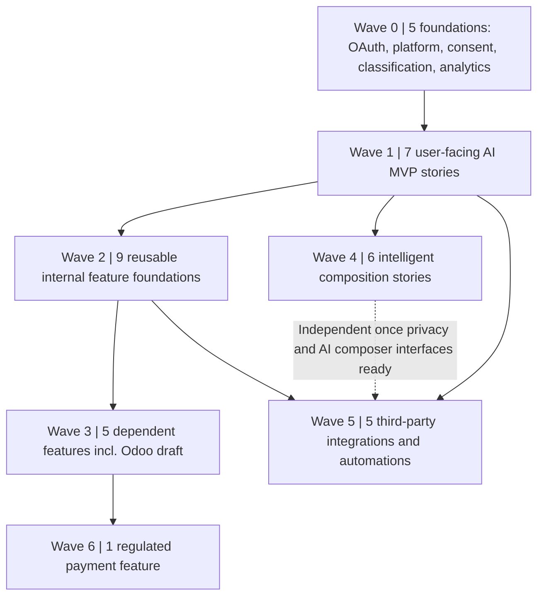

# MailXperts SDLC Wave Architecture: HLD + LLD Baseline

**Revision:** 2026-10-23 / revised draft engineering baseline. **Scope:** 38 unfinished requirements, 10 packages, optimised Waves 0–6. **Status:** DRAFT FOR TECHNICAL REVIEW, not approved architecture; future feature code, QA and UAT are not represented as complete.

## Source of truth and evidence

- [Machine-readable WBS and dependency edges](../traceability/WORK_BREAKDOWN_DEPENDENCIES.json)
- [Full requirements RTM](../traceability/RTM.csv)
- [66-requirement existing design/test catalogue](../traceability/DESIGN_AND_TEST_CATALOG.md)
- [AI product backlog](https://github.com/T1Xperts/MailXperts-Android/issues/29) and [release tracker](https://github.com/T1Xperts/MailXperts-Android/issues/11)

## High-level execution architecture

**Policy:** A dependency edge is an implementation sequencing relationship, not automatically proof that the upstream feature is approved or fully completed. Only the relevant read-only provider/gateway foundation of MX-QA-029 is a prerequisite for the AI MVP. Full Build Expert coding-agent capability is separately gated.

### Bounded-context boundaries

1. **Android client:** per-account message ownership, local metadata/cache, UI and user consent; must not contain AI provider or Odoo server credentials.
2. **AI gateway:** dedicated TLS service, authenticated, task-allowlisted, redacts sensitive content, disallows model-initiated mutation; no secrets or raw mailbox data in telemetry.
3. **Mailbox and third-party connectors:** least-privilege identity, account/tenant isolation, explicit permission and idempotent external writes.
4. **Finance service:** verified invoice extraction, Odoo draft-only create, separate payment initiator requiring human confirmation.
5. **Build Expert:** engineering-only separate trust boundary, no mobile access to code runner/production release/signing functions.
6. **Evidence store:** immutable (where supported) CI logs, test results, build SHA, UAT approvals and release control records.

### Lifecycle and release gates

Design proposed → engineering review → design approved → code branch → unit/security CI → integration QA → device UAT → Product Owner acceptance → human PR review/merge → signed release candidate → deploy/release → post-release verification. **Never auto-promote from static RTM test PASS to product UAT PASS.**

### External readiness worksheet

| Gate | Requirement IDs | Evidence state | Completion proof required |
|---|---|---|---|
| AI HTTPS gateway + secrets | AI-001 through AI-007 | Documented pending | Authorised HTTPS host, server-only provider key/client token, health monitoring, real result, device UAT |
| Gmail OAuth/XOAUTH2 | MX-QA-030 | Documented pending | Production-identity on-device receive/send/refresh test |
| Secure coding runner / platform | MX-QA-029 | Proposed additional phases | Approved isolated runner with no production secrets and comprehensive security UAT |
| Calendar API | AI-019 | Proposed | Provider policy, registration, consent, free/busy sandbox acceptance |
| ChatGPT connector | AI-025 | Proposed | Connector registration and end-user permission-scoped read test |
| Durable workflow runner | AI-026 | Proposed | Hosted job scheduler, retries, audit, identity and cancellation tested |
| Payment provider | AI-034 | Proposed | Provider onboarding/regulated payment flow, step-up confirmation test |
| Odoo instance | AI-036 | Proposed | Vendor-bill API, company mapping, least-privilege credentials, draft-only integration sandbox test |

## Functional decompositions

### BP-01: AI platform and P0 MVP

**Allocation:** 8 requirements: MX-QA-029, AI-001, AI-002, AI-003, AI-004, AI-005, AI-006, AI-007. **Waves:** Wave 0, Wave 1.

**HLD-BP-01:** Android AI workspace accesses a separately hosted HTTPS API, not the provider directly. The gateway authenticates an end-user client, scopes selected mail to an authorised account, redacts secrets, applies per-task policy and calls the model. Build Expert developer tools are a separate higher-privilege surface and cannot be accessed from the mail assistant.

**LLD-BP-01:** Reuse AiAssistantActivity, AiGatewayClient, AiPolicy and the server mail-assistant task router in draft PR #30. Validate gateway URL authority, avoid double endpoint paths, make no credential leakage to error messages or logs. Model responses are JSON with bounded fields, errors are safe, and user-written draft remains editable. MX-QA-029 shares the provider layer but does not gate P0 on its future coding-runner features.

**Automated test plan (planned until CI evidence):** P0 seven-task allow-list, deny send/delete/pay, forged authorization, prompt-injection in mail, redaction, 90KB context policy, TLS endpoint acceptance/rejection, timeout and malformed AI response; end-to-end live HTTPS server and physical-device UAT separate.

| Requirement | Feature | Internal predecessor(s) | External prereq. | Design | QA |
|---|---|---|---|---|---|
| MX-QA-029 | /B/u/i/l/d/ /E/x/p/e/r/t/ /p/r/o/v/i/d/e/r/ /o/r/c/h/e/s/t/r/a/t/i/o/n/ /f/o/u/n/d/a/t/i/o/n/ | None | proposed | Draft | partial automated QA only |
| AI-001 | /E/m/a/i/l///t/h/r/e/a/d/ /s/u/m/m/a/r/i/s/a/t/i/o/n/ | MX-QA-029 | documented_pending | Draft | automated pass live UAT pending |
| AI-002 | /C/o/n/t/e/x/t/u/a/l/ /r/e/p/l/y/ /d/r/a/f/t/i/n/g/ | MX-QA-029 | documented_pending | Draft | automated pass live UAT pending |
| AI-003 | /A/s/k/ /A/I/ /q/u/e/s/t/i/o/n/s/ /o/n/ /e/m/a/i/l///t/h/r/e/a/d/ | MX-QA-029 | documented_pending | Draft | automated pass live UAT pending |
| AI-004 | /N/a/t/u/r/a/l/-/l/a/n/g/u/a/g/e/ /m/a/i/l/b/o/x/ /s/e/a/r/c/h/ /p/l/a/n/n/i/n/g/ | MX-QA-029 | documented_pending | Draft | automated pass live UAT pending |
| AI-005 | /A/I/ /P/r/i/o/r/i/t/y/ /I/n/b/o/x/ | MX-QA-029 | documented_pending | Draft | automated pass live UAT pending |
| AI-006 | /A/c/t/i/o/n///d/a/t/e///d/e/c/i/s/i/o/n/ /e/x/t/r/a/c/t/i/o/n/ | MX-QA-029 | documented_pending | Draft | automated pass live UAT pending |
| AI-007 | /A/I/ /r/e/w/r/i/t/e///t/o/n/e/ /c/h/a/n/g/e/ | MX-QA-029 | documented_pending | Draft | automated pass live UAT pending |

**Exit:** HLD/LLD reviewed and approved, source/commit/PR-linked implementation, test case-by-case results, approved integration/device UAT where relevant, explicit version/merge/release evidence. 

### BP-02: Intelligent composition

**Allocation:** 6 requirements: AI-008, AI-014, AI-015, AI-024, AI-029, AI-030. **Waves:** Wave 4.

**HLD-BP-02:** Composition intelligence is layered above existing per-account composer and signature/recipient ownership. AI returns suggestions, not SMTP operations. Consent-controlled writing-style preference is segregated per account.

**LLD-BP-02:** Create ComposeAiService interfaces for suggestion, tone coaching, translation and subject. Include provenance to selected message/thread, bounded options, explicit insert/replace action, undo and hard separation from Send. Role-scoped template registry stores version, scope and approver. AI-015 model preference storage has opt-in and erase.

**Automated test plan (planned until CI evidence):** Prompt-injection cannot auto-send; cross-account leakage; UTF-8 languages; unsupported language fallback; undo for suggestions; shared template access denied when role missing.

| Requirement | Feature | Internal predecessor(s) | External prereq. | Design | QA |
|---|---|---|---|---|---|
| AI-008 | /O/n/e/-/t/a/p/ /s/u/g/g/e/s/t/e/d/ /r/e/p/l/i/e/s/ | AI-002 | None identified | Draft | not run |
| AI-014 | /T/o/n/e/ /a/n/d/ /c/l/a/r/i/t/y/ /c/o/a/c/h/i/n/g/ | AI-007 | None identified | Draft | not run |
| AI-015 | /P/e/r/m/i/s/s/i/o/n/e/d/ /p/e/r/s/o/n/a/l/ /w/r/i/t/i/n/g/ /s/t/y/l/e/ | AI-002, AI-035 | None identified | Draft | not run |
| AI-024 | /T/r/a/n/s/l/a/t/i/o/n/ /a/n/d/ /m/u/l/t/i/l/i/n/g/u/a/l/ /r/e/p/l/i/e/s/ | AI-002 | None identified | Draft | not run |
| AI-029 | /A/I/ /s/u/b/j/e/c/t/ /l/i/n/e/ /s/u/g/g/e/s/t/i/o/n/s/ | AI-002 | None identified | Draft | not run |
| AI-030 | /O/r/g/a/n/i/s/a/t/i/o/n/ /t/e/m/p/l/a/t/e/s/ | AI-002, AI-035 | None identified | Draft | not run |

**Exit:** HLD/LLD reviewed and approved, source/commit/PR-linked implementation, test case-by-case results, approved integration/device UAT where relevant, explicit version/merge/release evidence. 

### BP-03: Attention, briefing and voice

**Allocation:** 5 requirements: AI-009, AI-010, AI-021, AI-027, AI-031. **Waves:** Wave 2, Wave 3, Wave 5.

**HLD-BP-03:** Attention pipeline derives deadline/action state and priority explanations from authorised message context and local sync metadata. Notifications and spoken results subscribe to a read-only materialised briefing snapshot.

**LLD-BP-03:** Introduce FollowUpProjection based on extracted commitments with stable mail UID/account ID, false-positive dismissals and reminder dedupe. PriorityReason stores explainable factor references. BriefingStore aggregates ranked actions. NotificationService only schedules after opt-in. Voice consumes the same briefing text under microphone/speech permission.

**Automated test plan (planned until CI evidence):** Multiple threads same promise do not cause duplicate reminder; due-date timezone; incorrectly inferred dates flagged; revoked notification permissions; voice privacy and cancellation; no cross-account data exposure.

| Requirement | Feature | Internal predecessor(s) | External prereq. | Design | QA |
|---|---|---|---|---|---|
| AI-009 | /U/n/a/n/s/w/e/r/e/d///p/r/o/m/i/s/e/d/ /f/o/l/l/o/w/-/u/p/ /d/e/t/e/c/t/i/o/n/ | AI-006 | None identified | Draft | not run |
| AI-010 | /D/a/i/l/y/ /p/r/i/o/r/i/t/y/ /i/n/b/o/x/ /b/r/i/e/f/i/n/g/ | AI-005, AI-006, AI-009 | None identified | Draft | not run |
| AI-021 | /M/e/a/n/i/n/g/-/a/w/a/r/e/ /s/m/a/r/t/ /n/o/t/i/f/i/c/a/t/i/o/n/s/ | AI-005 | None identified | Draft | not run |
| AI-027 | /E/x/p/l/a/i/n/ /A/I/ /p/r/i/o/r/i/t/y/ /d/e/c/i/s/i/o/n/s/ | AI-005 | None identified | Draft | not run |
| AI-031 | /V/o/i/c/e/ /i/n/b/o/x/ /b/r/i/e/f/i/n/g/ | AI-010 | None identified | Draft | not run |

**Exit:** HLD/LLD reviewed and approved, source/commit/PR-linked implementation, test case-by-case results, approved integration/device UAT where relevant, explicit version/merge/release evidence. 

### BP-04: Tasks, calendar and workflow automation

**Allocation:** 5 requirements: AI-017, AI-018, AI-019, AI-020, AI-026. **Waves:** Wave 2, Wave 5.

**HLD-BP-04:** Mailbox action engine separates inferred intent, preview, user approval, execution and audit. Calendars, reminders and automations use permissioned connectors with durable scheduling when configured.

**LLD-BP-04:** TaskDraft/CalendarDraft carry source message ID and confidence. TimeFinder accesses user-consented free/busy slots only. RuleCompiler emits previewable account-scoped filter/action pairs. WorkflowRunner persists idempotency key, trigger, condition, execution status, cancellation and per-step audit with explicit approval for sends, external writes and destructive actions.

**Automated test plan (planned until CI evidence):** Missing date leaves draft editable; no unsolicited invitations; timezone and recurrence; cross-tenant calendar scope; replayed rule events do not duplicate actions; workflow cancellation and service outage retry.

| Requirement | Feature | Internal predecessor(s) | External prereq. | Design | QA |
|---|---|---|---|---|---|
| AI-017 | /E/m/a/i/l/-/t/o/-/t/a/s/k/ /c/r/e/a/t/i/o/n/ | AI-006 | None identified | Draft | not run |
| AI-018 | /E/m/a/i/l/-/t/o/-/c/a/l/e/n/d/a/r/ /e/v/e/n/t/ | AI-006 | None identified | Draft | not run |
| AI-019 | /A/I/-/a/s/s/i/s/t/e/d/ /s/c/h/e/d/u/l/i/n/g/ | AI-018 | proposed | Draft | not run |
| AI-020 | /M/a/i/l/b/o/x/ /r/u/l/e/ /c/r/e/a/t/i/o/n/ /i/n/ /p/l/a/i/n/ /E/n/g/l/i/s/h/ | AI-004 | None identified | Draft | not run |
| AI-026 | /N/a/t/u/r/a/l/-/l/a/n/g/u/a/g/e/ /a/u/t/o/m/a/t/i/o/n/ | AI-017, AI-020 | proposed | Draft | not run |

**Exit:** HLD/LLD reviewed and approved, source/commit/PR-linked implementation, test case-by-case results, approved integration/device UAT where relevant, explicit version/merge/release evidence. 

### BP-05: Attachment, context and analytics

**Allocation:** 4 requirements: AI-012, AI-013, AI-032, AI-033. **Waves:** Wave 0, Wave 2, Wave 3.

**HLD-BP-05:** Read-only document and conversation intelligence uses safe MIME/attachment extraction and permission-scoped context assembly. Analytics are aggregates separated by account/tenant.

**LLD-BP-05:** AttachmentExtractor enforces MIME allow-list, size/page limits and text extraction sandbox. SynthesisService links supporting message IDs and timestamps. TimelineProjector derives chronological entities with provenance and edit/reject affordances. AnalyticsAggregator stores bounded redacted metrics, not raw message replicas.

**Automated test plan (planned until CI evidence):** Oversized/malicious attachments rejected; embedded instructions ignored; merged timelines properly ordered; attachments with no text cause explicit low-confidence; aggregate permissions and anonymisation.

| Requirement | Feature | Internal predecessor(s) | External prereq. | Design | QA |
|---|---|---|---|---|---|
| AI-012 | /A/t/t/a/c/h/m/e/n/t/ /i/n/t/e/l/l/i/g/e/n/c/e/ | AI-001 | None identified | Draft | not run |
| AI-013 | /M/u/l/t/i/-/e/m/a/i/l/ /s/y/n/t/h/e/s/i/s/ | AI-001 | None identified | Draft | not run |
| AI-032 | /C/u/s/t/o/m/e/r///p/r/o/j/e/c/t/ /t/i/m/e/l/i/n/e/ | AI-013 | None identified | Draft | not run |
| AI-033 | /B/u/s/i/n/e/s/s/ /m/a/i/l/b/o/x/ /c/o/m/m/u/n/i/c/a/t/i/o/n/ /a/n/a/l/y/t/i/c/s/ | None | None identified | Draft | not run |

**Exit:** HLD/LLD reviewed and approved, source/commit/PR-linked implementation, test case-by-case results, approved integration/device UAT where relevant, explicit version/merge/release evidence. 

### BP-06: Classification and noise controls

**Allocation:** 3 requirements: AI-022, AI-023, AI-028. **Waves:** Wave 0, Wave 2, Wave 3.

**HLD-BP-06:** A reversible mail classification layer proposes categories and human-correctable noise rules. Account/folder isolation and local overrides supersede model inference.

**LLD-BP-06:** ClassificationDecision stores message identity, model/rule version, label, confidence and user override. BulkClassifier suppresses false positives using send-list context. UnsubscribeAdvisor only displays authenticated candidate URL/action; unsubscribe/block execution waits for explicit confirmation.

**Automated test plan (planned until CI evidence):** VIP mail not silently hidden; reversible classification; crafted unsubscribe phishing link never auto-opened; cross-account categories remain independent.

| Requirement | Feature | Internal predecessor(s) | External prereq. | Design | QA |
|---|---|---|---|---|---|
| AI-022 | /S/m/a/r/t/ /A/I/ /m/a/i/l/ /c/l/a/s/s/i/f/i/c/a/t/i/o/n/ | None | None identified | Draft | not run |
| AI-023 | /N/e/w/s/l/e/t/t/e/r///n/o/i/s/e/ /f/i/l/t/e/r/i/n/g/ | AI-022 | None identified | Draft | not run |
| AI-028 | /C/o/n/f/i/r/m/e/d/ /u/n/s/u/b/s/c/r/i/b/e///b/l/o/c/k/ /r/e/c/o/m/m/e/n/d/a/t/i/o/n/s/ | AI-023 | None identified | Draft | not run |

**Exit:** HLD/LLD reviewed and approved, source/commit/PR-linked implementation, test case-by-case results, approved integration/device UAT where relevant, explicit version/merge/release evidence. 

### BP-07: Invoice, Odoo and payments

**Allocation:** 3 requirements: AI-016, AI-034, AI-036. **Waves:** Wave 3, Wave 6.

**HLD-BP-07:** Finance isolation: invoice detection/extraction is read-only; accounting integration creates draft-only Odoo vendor bills; any payment initiation is a distinct user-confirmed workflow. All external financial writes pass consent, company selection, duplicate checking and an append-only audit.

**LLD-BP-07:** InvoiceDocument -> ExtractedInvoice with explicit confidence per field -> vendor/account/tax mapper -> dedupe query -> create Odoo account.move with move_type=in_invoice and state=draft in intended company -> source-file reference/audit receipt. Reject any model-suggested state=posted or execute-post action. BillPayExecutor is separate and must require strong step-up verification plus payee confirmation.

**Automated test plan (planned until CI evidence):** Invoice duplicates, mismatched vendor/company/currency, missing tax ID, prompt-injection invoice, idempotent retry, attachment audit; assert create only draft, no post/pay routes; payment provider sandbox, device confirmation and refund/cancellation negative paths.

| Requirement | Feature | Internal predecessor(s) | External prereq. | Design | QA |
|---|---|---|---|---|---|
| AI-016 | /I/n/v/o/i/c/e/ /a/n/d/ /b/i/l/l/ /e/x/t/r/a/c/t/i/o/n/ | AI-006, AI-012 | None identified | Draft | not run |
| AI-034 | /E/x/p/l/i/c/i/t/ /B/i/l/l/P/a/y/ /i/n/i/t/i/a/t/i/o/n/ | AI-016 | proposed | Draft | not run |
| AI-036 | /D/r/a/f/t/-/o/n/l/y/ /O/d/o/o/ /v/e/n/d/o/r/ /b/i/l/l/ | AI-016 | proposed | Draft | not run |

**Exit:** HLD/LLD reviewed and approved, source/commit/PR-linked implementation, test case-by-case results, approved integration/device UAT where relevant, explicit version/merge/release evidence. 

### BP-08: Cross-account AI and ChatGPT

**Allocation:** 2 requirements: AI-011, AI-025. **Waves:** Wave 5.

**HLD-BP-08:** Permission-scoped cross-account query service builds a secure source-index view. ChatGPT integration is a narrow connector with revocable OAuth/service identity and separate read/write scopes.

**LLD-BP-08:** MailboxSearchTool performs server-side permission recheck for every account and returns minimal message snippets, IDs and provenance. Connector manifest/version defines list/search/read capabilities first; mutating actions are separate registered tools with explicit high-risk confirmations, tenant boundaries, token expiry and audit.

**Automated test plan (planned until CI evidence):** Authorised and denied account combinations; revoked token, metadata leakage, tampered source ID and prompt-injection; connector does not expose pay/delete without step-up approval.

| Requirement | Feature | Internal predecessor(s) | External prereq. | Design | QA |
|---|---|---|---|---|---|
| AI-011 | /C/r/o/s/s/-/a/c/c/o/u/n/t/ /A/I/ /Q/&/A/ | AI-003, AI-035 | None identified | Draft | not run |
| AI-025 | /C/h/a/t/G/P/T/ /↔/ /M/a/i/l/X/p/e/r/t/s/ /i/n/t/e/g/r/a/t/i/o/n/ | AI-011, AI-035 | proposed | Draft | not run |

**Exit:** HLD/LLD reviewed and approved, source/commit/PR-linked implementation, test case-by-case results, approved integration/device UAT where relevant, explicit version/merge/release evidence. 

### BP-09: Privacy and consent

**Allocation:** 1 requirements: AI-035. **Waves:** Wave 0.

**HLD-BP-09:** Central user-controlled privacy policy gate for model-provider routing, retention/redaction, no-training consent and on-device fallback; default cloud transmission disabled until authorised.

**LLD-BP-09:** AiConsentStore stores user, account, purpose, provider, timestamp and revocation. DataMinimiser redacts identifying/payment/token fields before request logging and model transmission. On-device option reports unsupported models accurately, with no claim of offline processing when still cloud-backed.

**Automated test plan (planned until CI evidence):** Opt-out/consent revocation immediately blocks new requests; secret redaction; data residency disclosures; per-account scope; no raw mail in telemetry; no provider secret in APK.

| Requirement | Feature | Internal predecessor(s) | External prereq. | Design | QA |
|---|---|---|---|---|---|
| AI-035 | /A/I/ /p/r/i/v/a/c/y/,/ /c/o/n/s/e/n/t/ /a/n/d/ /o/n/-/d/e/v/i/c/e/ /c/o/n/t/r/o/l/s/ | None | None identified | Draft | not run |

**Exit:** HLD/LLD reviewed and approved, source/commit/PR-linked implementation, test case-by-case results, approved integration/device UAT where relevant, explicit version/merge/release evidence. 

### BP-10: Provider authentication acceptance

**Allocation:** 1 requirements: MX-QA-030. **Waves:** Wave 0.

**HLD-BP-10:** Provider-neutral OAuth2/XOAUTH2 remains distinct from AI gateway authentication. Device gate tests provider registration, consent scopes and token/IMAP/SMTP mechanics using production signing identity.

**LLD-BP-10:** Exercise GoogleOAuthManager, MicrosoftOAuthManager, MailAuth and OAuthConnectActivity with accepted app registration, Gmail mail scope, JavaMail XOAUTH2, refresh/re-consent, account isolation and provider-specific diagnostics. Keep client secrets outside source and do not close if live Gmail IMAP rejects granted token.

**Automated test plan (planned until CI evidence):** Device test: Google OAuth → consent scope → IMAP list → SMTP send → refresh → background sync; Microsoft separate; error screenshot/log, tester, build SHA and outcome required.

| Requirement | Feature | Internal predecessor(s) | External prereq. | Design | QA |
|---|---|---|---|---|---|
| MX-QA-030 | /P/r/o/v/i/d/e/r/ /O/A/u/t/h/2///X/O/A/U/T/H/2/ /d/e/v/i/c/e/ /v/a/l/i/d/a/t/i/o/n/ | None | documented_pending | Draft | automated pass device UAT pending |

**Exit:** HLD/LLD reviewed and approved, source/commit/PR-linked implementation, test case-by-case results, approved integration/device UAT where relevant, explicit version/merge/release evidence. 

## Test data and acceptance structure

Every `TC-<requirement>-01` in the existing catalogue is a **proposed scenario**, not an executed case. For each feature QA implementation, record: `test_case_id`, build commit SHA, environment/device/provider versions, actual vs expected, run link, tester, outcome PASS/FAIL/BLOCKED, evidence URI, linked defect, retest cycle and approver. Add negative tests for missing scopes, timeouts, duplicate actions, revoked consent, adversarial message content and crash recovery.

The `scripts/qa-traceability.py` contract suite verifies dependency completeness, wave DAG, WBS alignment, 66-RTM ID coverage and safety invariants. This is **static governance QA only**. It cannot validate product features, Android builds or UAT. Android/Node runtime testing stays with the existing CI plus package-specific automated suites.

## Immediate engineering tasks, revised seven-wave sequence

- **Wave 0 (5):** MX-QA-029 secure foundation, MX-QA-030 OAuth device retest, AI-035 consent/on-device alternatives, AI-022 classification and AI-033 analytics. **Current status:** platform partial, OAuth code complete/UAT pending, consent partial, classification and analytics not built.
- **Wave 1 (7):** AI-001..007 AI MVP code complete in draft PR #30 with privacy/security hardening PR #33, beta.10 VC24 candidate signed offline for internal QA. Android/P0/Node CI pass; hosted HTTPS AI gateway and physical-device UAT pending.
- **Wave 2 (9):** AI-009, 012, 013, 017, 018, 020, 021, 023, 027. Dependency-matched foundations.
- **Wave 3 (5):** AI-016 then AI-036 draft-only Odoo bill, plus AI-010, 028 and 032. Odoo external acceptance remains separate.
- **Wave 4 (6):** AI-008, 014, 015, 024, 029, 030. These may run in parallel after their individual P0/privacy interfaces are ready.
- **Wave 5 (5):** AI-011 before AI-025, AI-019, 026, 031; calendar/provider/connector/hosting integrations gated by credentials and real UAT.
- **Wave 6 (1):** AI-034 BillPay pilot behind regulated provider readiness, strong identity, human confirmation and full audit.

Dependency edges mean ordered design/code integration, not a claim that earlier waves are fully approved; independently ready work may run in parallel. Under no circumstances should a successful CI build be recorded as a completed user/device UAT.

**No source code or service credential is approved for production solely by the existence of this HLD/LLD document.**
