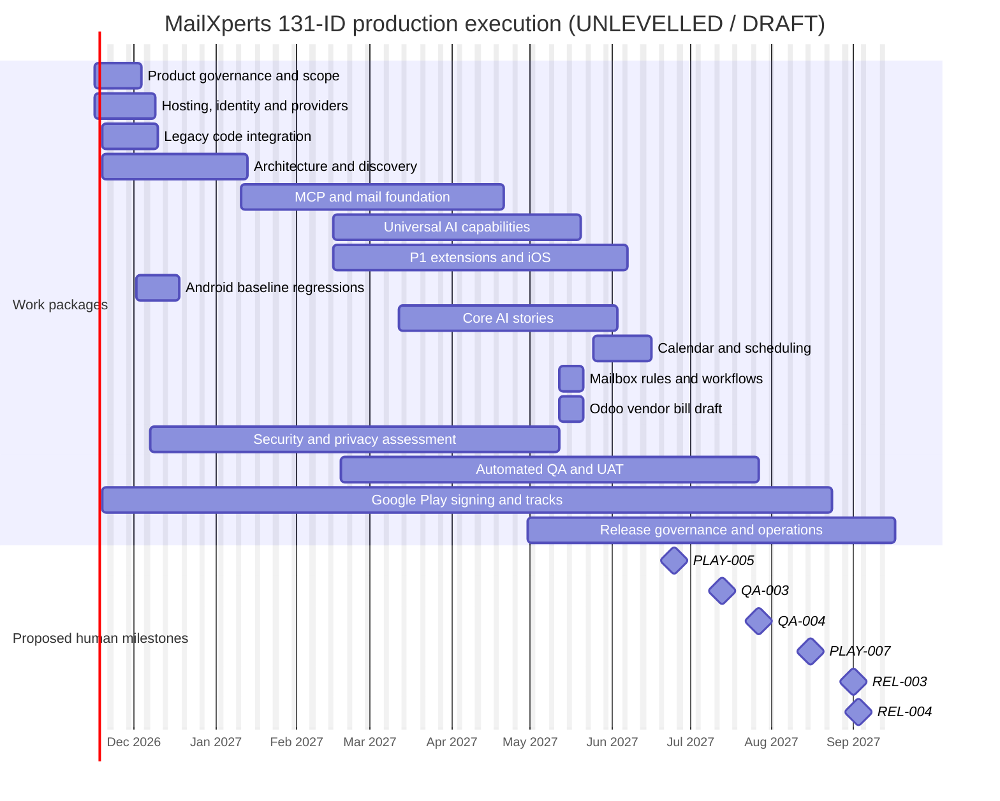

# MailXperts P0/P1 production execution Gantt (draft)

**Scope:** 131 P0/P1 requirement IDs plus 33 execution and release tasks = 164 scheduled tasks. **Planning start:** 16 November 2026 (Melbourne weekdays and provisional holiday calendar). **NOT RESOURCE LEVELLED OR APPROVED**. Dependencies/estimated dates will move after provider registrations, staffing and security decisions. Existing 94-story read-only beta plan is superseded **for full-P0/P1 production scoping only**, not as recorded historical evidence.

> GitHub renders this compact *work package* Gantt. The task-level complete Gantt data, with 164 start/finish records and 572 FS/SS/FF/SF edges, lives in the linked CSV. Do not infer a confirmed release from visualised dates.

## Work package dates and work volume

| WBS | Work package | Tasks | Earliest start | Latest finish |
|---|---|---:|---|---|
| WP-GOV | Product governance and scope | 5 | 2026-11-16 | 2026-12-04 |
| WP-INF | Hosting, identity and providers | 5 | 2026-11-16 | 2026-12-09 |
| WP-ENG | Legacy code integration | 2 | 2026-11-19 | 2026-12-10 |
| WP-W0 | Architecture and discovery | 11 | 2026-11-19 | 2027-01-13 |
| WP-W1 | MCP and mail foundation | 22 | 2027-01-11 | 2027-04-21 |
| WP-W2 | Universal AI capabilities | 29 | 2027-02-15 | 2027-05-20 |
| WP-W3 | P1 extensions and iOS | 18 | 2027-02-15 | 2027-06-07 |
| WP-ANDROID-BASE | Android baseline regressions | 23 | 2026-12-02 | 2026-12-18 |
| WP-LEGACY-AI | Core AI stories | 23 | 2027-03-12 | 2027-06-03 |
| WP-CALENDAR | Calendar and scheduling | 2 | 2027-05-25 | 2027-06-16 |
| WP-WORKFLOW | Mailbox rules and workflows | 2 | 2027-05-12 | 2027-05-21 |
| WP-ODOO-DRAFT | Odoo vendor bill draft | 1 | 2027-05-12 | 2027-05-21 |
| WP-SEC | Security and privacy assessment | 2 | 2026-12-07 | 2027-05-12 |
| WP-QA | Automated QA and UAT | 4 | 2027-02-18 | 2027-07-27 |
| WP-PLAY | Google Play signing and tracks | 8 | 2026-11-19 | 2027-08-24 |
| WP-REL | Release governance and operations | 7 | 2027-04-30 | 2027-09-17 |

**Task-level Gantt data:** [164-task schedule](P0P1_PRODUCTION_EXECUTION_SCHEDULE_2026-11-14.csv), [572-link dependency register](P0P1_EXECUTION_DEPENDENCIES_2026-11-14.csv), [all 131 individual requirement scope/gaps](P0P1_RELEASE_SCOPE_2026-11-14.csv), [16 work packages](P0P1_WORK_PACKAGES_2026-11-14.csv), [nine dependency repairs](P0P1_DEPENDENCY_REPAIRS_2026-11-14.csv).

## Proposed release milestones (dates are not commitments)

| Release gate | Calculated date | Condition |
|---|---|---|
| PLAY-005 | 25 June 2027 | All 131 implementation tasks complete; signed QA APK and Play AAB created by private release custodian |
| QA-003 | 13 July 2027 | UAT individually executed on signed candidate |
| QA-004 | 27 July 2027 | Final automated security/regression suites executed |
| PLAY-007 | 16 August 2027 | Play internal/closed testing complete, if applicable |
| REL-001 | 30 August 2027 | Scope, defect and evidence gate complete |
| REL-003 | 1 September 2027 | **Explicit human** go/no-go |
| REL-004 | 2–3 September 2027 | Manual submission task only; store review time excluded |

**Capacity blocker:** Same-role collisions reach 22 simultaneous Android Engineer tasks and 10 LLM/AI Engineer tasks. **No real staffing assignments confirmed.** Level capacity, split genuine teams, and estimate external lead time before committing to dates.

**SF handover:** `OPS-LIVE SF+0d -> OPS-INTERIM` means the interim manual monitoring task cannot finish before live monitoring starts. The other relationship types include SS and FF, but most hard delivery predecessors are FS; see all edges in the dependency register.

**Governance:** No APK/AAB has been built or signed by this planning change; no signing key, OAuth token, email credential or production deploy is present.
